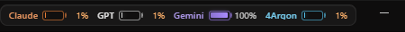
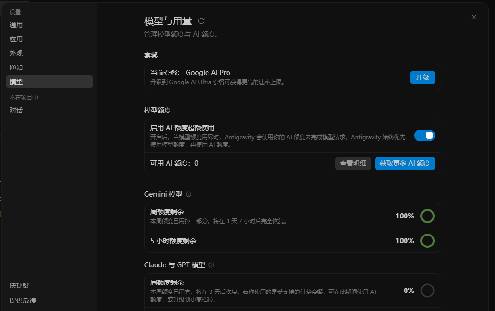

# 反重力中文增强补丁（agy-cn）

[](../../releases)
[](#安装)
[](https://antigravity.google)
[](LICENSE)

给 **Google Antigravity 桌面版** 加两样东西：

> 🔁 **本项目长期维护**：跟随 Antigravity 版本持续适配更新，欢迎 [Issues](../../issues) 反馈问题和需求。

1. **顶栏模型额度小电池** —— Claude（橙）/ GPT（白）/ Gemini（紫）/ 4Argon（蓝），实时显示各家剩余额度，鼠标悬停看明细，点一下立刻刷新。
2. **基础汉化** —— 顶栏菜单、侧栏、输入框、额度提示、常用按钮、整页设置界面换成中文，**不碰对话正文、代码和输入框里的内容**。



---

## 安装

从 [Releases](../../releases) 下载 `agy-cn-v*.zip` 并解压，双击 `install.bat`（或命令行 `python install.py`），然后**从托盘完整退出 Antigravity 再重新打开**。

安装脚本会做三件事：

| 步骤 | 内容 |
| --- | --- |
| 1 | 备份 `resources\app.asar` → `app.asar.agyq-backup`（应用版本变了会自动重建备份） |
| 2 | 把 `inject.js` / `inject.css` **内联**进 asar 里的 `dist/preload.js` |
| 3 | 由 preload 在每次页面加载时用 `webFrame.executeJavaScript` 注入到主世界 |
| 4 | **关闭后台自动更新检查**（改 `dist/updater.js`），避免升级把补丁冲掉 |

> 为什么是内联：Electron 20 起 renderer 默认 `sandbox: true`，preload 里 **没有 `fs`**（`require('fs')` 会报 `module not found: fs`），读不了外部文件，只能把脚本塞进 preload 本身。

## 卸载

双击 `restore.bat`（或 `python install.py --restore`），重启应用即可恢复官方状态。

`python install.py --check` 可以查看当前是否已安装。

---

## 额度电池怎么取数

数据来自应用自己的接口：

```
POST /exa.language_server_pb.LanguageServerService/GetUserStatus
```

返回里的 `cascadeModelConfigData.clientModelConfigs[]` 每个模型带 `quotaInfo`，配合 `planStatus` 的共享积分：

- 某厂商模型**有** `remainingFraction` → 取该厂商所有模型里**最低**的那个百分比（Gemini、4Argon 属于这类，各自独立额度）。
- 某厂商模型**没有** `remainingFraction` → 用「共享积分」的剩余比例（Claude / GPT 这类走 Pro 套餐积分池）。
- **Gemini 4 Argon 单独一块电池**（v1.2 起）：Argon 的周额度独立于普通 Gemini，不共用额度池。模型 ID 或名称里带 `argon` 的归 4Argon 电池（Gemini 归类时已用负向匹配排除），所以 Gemini 电池不再被 Argon 的用量拉低。
- 账号 / 套餐里**没有**某厂商的模型时，对应电池自动隐藏。
- 每 60 秒自动刷新一次；切回窗口、点击组件时也会立即刷新。

颜色：Claude `#FF8A3D`、GPT `#F0F0F0`、Gemini `#A98BFF`、4Argon `#4A9EFF`。低于 15% 数字变橙，归零时电池边框呼吸闪烁。



## 汉化怎么改

`inject.js` 里有两个地方可以扩展：

```js
const DICT = { 'New Conversation': '新建对话', ... };   // 精确匹配
const RULES = [ [/^Worked for (.+)$/, '工作用时 $1'], ... ]; // 带变量的句子
```

改完词条要重新跑一次 `install.py`（脚本会重新内联进 asar），然后**重启应用**生效。

**不会翻译的区域**（`SKIP_SEL`）：`code` / `pre` / `textarea` / `contenteditable` / `.markdown` / `.prose` / 对话气泡（`turn-cards-container`）/ 侧栏对话标题（`conversation-row-sidebar`）/ 用户输入（`user-input-step`）。这样聊天记录和代码永远保持原样。

---

## 已知情况

- **自动更新已被关闭**（`startAutoUpdateChecks` 改成空函数）：应用不会再后台检查/下载新版本，补丁也就不会被覆盖。
  菜单里手动的「检查更新」仍然可用；想彻底恢复自动更新，跑 `restore.bat` 还原官方 `app.asar` 即可。
- 如果哪天手动升级了应用（或重装），补丁会失效 —— 重新跑一次 `install.bat` 就行，它会检测到新版本并用当前文件重建备份。
- 现在的 UI 是 2.25.0 的；设置页（通用/应用/外观/通知/模型与用量/快捷键/反馈/账号）已整体汉化。
- 汉化是 DOM 层的，少数动态提示（输入框轮播的 hint）在切换瞬间可能出现一次英文/中英混排，下一帧会恢复。
- 模型名和档位（`Gemini 4 Argon`、`Medium` / `High`）故意保留英文，避免和额度对照时认错。
- 如果窗口里看不到组件：应用内按 `Ctrl+Shift+I` 打开开发者工具，控制台里 `[agy-cn]` 开头的日志会说明原因（正常应看到 `preload bootstrap ok`，每次拉数还会打印 `[agy-cn] 模型配置：` 的模型清单）。
- **改完 asar 必须完整退出应用再打开**（托盘 → Quit），只刷新页面会读到旧缓存，出现 `Unable to load preload script ... SyntaxError`。

## 变更日志

见 [CHANGELOG.md](CHANGELOG.md)。

## 免责声明

本项目为非官方第三方增强补丁，与 Google / Antigravity 官方无关。脚本会修改本地 `app.asar`，请知悉风险并自行承担；补丁只读写本地文件，不上传任何数据。

## License

[MIT](LICENSE)
